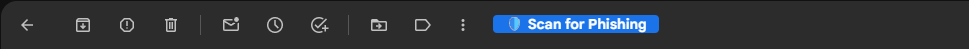
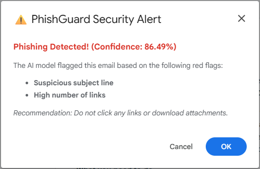
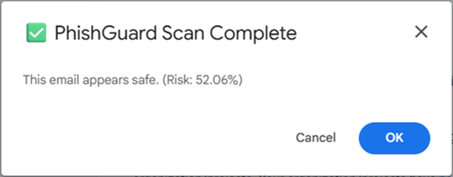

# PhishGuard

Phishing detection for Gmail that explains its verdicts.

PhishGuard is a Chrome extension (Manifest V3) that adds a **Scan for Phishing** button to Gmail. When you click it, the extension extracts 10 features from the open email and sends them to a FastAPI service. The service runs a CatBoost classifier and returns a verdict, a confidence score and, for flagged emails, the top reasons behind the verdict, derived from SHAP values.

Built as an undergraduate Special Problem for the BS Computer Science program at the University of the Philippines Los Baños (January to April 2026).



| Flagged email | Email below the threshold |
| :---: | :---: |
|  |  |

## How it works

1. **Feature extraction (extension).** `src/extension.js` uses [gmail.js](https://github.com/KartikTalwar/gmail.js) to read the open email and builds a 10-feature payload:
   - Text: `subject`, `body` (HTML stripped)
   - URLs: `url_count`, `url_length_max`, `url_length_avg`, `url_subdom_max`, `url_subdom_avg`
   - Attachments: `attachment_count`, `has_attachments`, `attachment_types` (file extensions)
2. **Request.** The payload goes from the page to the content script (`src/extensionInjector.js`), then to the background service worker (`background.js`), which sends it to `POST /predict`.
3. **Prediction (backend).** `main.py` loads the trained model (`phishguard.cbm`) and computes the phishing probability. An email is flagged only when the probability is above **0.85**.
4. **Explanation.** For flagged emails, the backend computes SHAP values for the request, takes the two features that pushed the prediction most strongly toward "phishing", and maps them to plain-language warnings such as "Suspicious subject line" or "High number of links".
5. **Result.** The extension shows the verdict in a Gmail modal.

Sender domain is deliberately not a feature, to keep the model from overfitting to the domains that appear in historical data.

### What leaves the browser

Scanning is on demand: nothing is sent until you click the button. A scan sends the subject, the body text and the URL and attachment statistics of that one email to the backend. As written, the backend does not store requests; it logs only the verdict, the confidence and the reasons.

## Results

The model was trained on the [MeAJOR corpus](https://doi.org/10.5281/zenodo.18471483) with an 80/20 stratified split, and evaluated on the 21,737 held-out emails.

### Decision threshold

| Threshold | Precision | Recall | F1 |
| :---: | :---: | :---: | :---: |
| 0.50 | 0.9799 | 0.9773 | 0.9786 |
| 0.60 | 0.9829 | 0.9708 | 0.9768 |
| 0.70 | 0.9873 | 0.9621 | 0.9745 |
| 0.80 | 0.9892 | 0.9520 | 0.9702 |
| **0.85** | **0.9907** | **0.9439** | **0.9667** |
| 0.90 | 0.9928 | 0.9322 | 0.9616 |
| 0.95 | 0.9950 | 0.9051 | 0.9479 |

The deployed threshold is 0.85. It gives up about 3.3 points of recall compared with 0.50 in exchange for fewer false alarms: 85 false positives out of 12,130 legitimate emails, a 0.70% false-positive rate.

| At 0.85 | Predicted benign | Predicted phishing |
| :--- | :---: | :---: |
| **Actually benign** | 12,045 | 85 |
| **Actually phishing** | 539 | 9,068 |

### Feature ablation (threshold 0.50)

| Feature set | Accuracy | Precision | Recall | F1 |
| :--- | :---: | :---: | :---: | :---: |
| Text only | 0.9784 | 0.9775 | 0.9736 | 0.9755 |
| Text + URL | 0.9815 | 0.9802 | 0.9779 | 0.9791 |
| Text + attachment | 0.9784 | 0.9789 | 0.9720 | 0.9755 |
| Text + URL + attachment | 0.9811 | 0.9799 | 0.9773 | 0.9786 |

URL features account for most of the gain over text alone.

### Latency and usability

- The deployed API averaged **71.79 ms** per response in live tests, including the SHAP explanation.
- The extension scored **84.5** on the System Usability Scale with 20 participants.

## Repository layout

```
phishguard backend/
  main.py            FastAPI service: /predict endpoint, threshold, SHAP explanations
  train.py           Preprocessing, ablation study, training and threshold analysis
  phishguard.cbm     Trained CatBoost model
  meajor_cleaned_preprocessed.parquet.gzip   Preprocessed training data
  requirements.txt   Dependencies for serving
phishguard frontend/
  manifest.json      Chrome extension manifest (V3)
  background.js      Service worker that calls the backend
  src/               Gmail integration, feature extraction and UI
SETUP.md             Step-by-step development setup
```

## Getting started

See [SETUP.md](SETUP.md) for the full walkthrough. In short:

```bash
# Backend
cd "phishguard backend"
pip install -r requirements.txt
uvicorn main:app --reload --host 127.0.0.1 --port 8000
```

```bash
# Extension
cd "phishguard frontend"
npm install
npm run build
```

Then open `chrome://extensions`, enable Developer mode, click **Load unpacked** and select the `phishguard frontend` folder. To use a local backend, change the URL in `background.js` to `http://localhost:8000/predict`.

### Retraining

`train.py` reruns the ablation study, trains the final model and prints the threshold analysis. Its dependencies (scikit-learn and pyarrow) are included in `requirements.txt`. It also needs a CUDA-capable GPU, because the script sets `task_type="GPU"`.

## Tech stack

- **Model:** CatBoost, SHAP values via CatBoost's built-in calculator, pandas
- **Backend:** Python, FastAPI, Uvicorn, deployed on Render
- **Extension:** JavaScript, Chrome Manifest V3, gmail.js, jQuery, esbuild

## Dataset

Cardoso, F., Vitorino, J., Mendes, P., Maia, E., & Praça, I. (2026). *MeAJOR: Merged email Assets from Joint Open-source Repositories* [Dataset]. Zenodo. https://doi.org/10.5281/zenodo.18471483

Mendes, P., Maia, E., & Praça, I. (2025). *MeAJOR Corpus: a Multi-Source Dataset for Phishing Email Detection.* arXiv. https://doi.org/10.48550/arxiv.2507.17978

## Author

Cedric Allen F. Mercado · [github.com/cfmercado](https://github.com/cfmercado)

## License

The code in this repository is released under the [MIT License](LICENSE). The MeAJOR dataset is the work of its authors and is covered by its own terms, not by this licence; see the dataset links above.
